# SWS405 — Lab 4 Submission Report
## The Sleuth Kit: Create, Delete and Recover Digital Evidence

| | |
|---|---|
| **Course** | SWS405 — Digital Forensics |
| **Lab** | Lab 4 — The Sleuth Kit Hands-On |
| **Student name** | Kinley Palden |
| **Student ID** | 02230287 |
| **Instructor** | Mr. Pema Thinley |
| **Date performed** | 14 October 2026 |
| **Platform** | Kali Linux (Linux 7.1.5 kali-amd64), The Sleuth Kit ver 4.14.0 |

---

## 1. Objective

Build a 200 MB NTFS disk image, plant eight files of different types plus one control file, delete them, and then recover every deleted file using The Sleuth Kit (TSK) — proving each recovery is bit-for-bit identical to the original with SHA-256 hashes, and proving the evidence image itself was never modified during analysis.

## 2. Scenario

A USB drive was seized from a Finance employee suspected of leaking "Project Falcon" data. Before seizure, the suspect deleted a report, a photo, a contract, a password list and other files. The task is to analyse the drive image, locate the deleted files, examine their metadata, recover them, and prove the recovered files are unaltered.

## 3. Methodology (summary)

The lab was carried out in two roles, following forensic best practice:

- **Parts 2–4 (suspect role):** created `evidence.dd`, wrote an MBR partition table with one NTFS partition starting at sector 2048, formatted and mounted it, planted nine files (`python3 make_files.py`), recorded original SHA-256 hashes, deleted all files except the control `readme.txt`, unmounted, hashed the whole image (acquisition hash) and set it read-only.
- **Parts 5–7 (investigator role):** working **read-only**, verified the acquisition hash, identified the partition offset (`mmls`), the file system (`fsstat`), the deleted file names and MFT entries (`fls`), and per-file metadata (`istat`). Recovered each file with `icat -r`, verified with `sha256sum -c`, performed bulk recovery with `tsk_recover`, built a MACB timeline with `fls -m` + `mactime`, and re-verified the image hash to prove it was unchanged.

**Tools used:** `dd`, `parted`, `losetup`, `mkfs.ntfs`, `mount`, `python3`, `file`, `sha256sum`, `img_stat`, `mmls`, `fsstat`, `fls`, `istat`, `ffind`, `icat`, `blkcat`, `tsk_recover`, `fls -m`, `mactime`.

---

## 4. Lab Report Table (my results)

| Item | My value | Command it came from |
|---|---|---|
| Image SHA-256 (before analysis) | `971a99be9f6773c6864575d4a1dd3e5b5672b632529fbf544e358a982088f403` | `sha256sum` |
| Image type and size | raw, 209,715,200 bytes (200 MiB), 512-byte sectors | `img_stat` |
| Partition start sector (offset) | **2048** | `mmls` |
| File system type / volume name | NTFS / **EVIDENCE** | `fsstat` |
| Volume serial number | 1A2CE70C59226D47 | `fsstat` |
| Cluster size / MFT entry size | 4096 bytes / 1024 bytes | `fsstat` |
| MFT entry range | 0 – 74 (75 entries) | `fsstat` |
| Number of deleted files found | **8 files** (+ the `Confidential` folder) | `fls -r -d -p` |
| MFT entry of `report.pdf` | **67** | `fls` |
| `report.pdf` created time | 2026-10-14 02:06:13 (+06) = 2026-10-13 20:06:13 UTC | `istat` |
| `report.pdf` data cluster | **25984** (non-resident, 4030 bytes) | `istat` |
| Files recovered / hashes matching | **8 / 8 — all OK** | `icat`, `sha256sum -c` |
| Time the `Confidential` folder was emptied | 2026-10-13 20:07:55 UTC (≈ 1 min 42 s after creation) | `mactime` |
| Image SHA-256 (after analysis) matches? | **YES — `evidence.dd: OK`** | `sha256sum -c` |

---

## 5. Evidence Integrity

| Checkpoint | SHA-256 of `evidence.dd` | Result |
|---|---|---|
| At acquisition (Part 4, image sealed `chmod 444`) | `971a99be…2088f403` | recorded in `evidence.dd.sha256` |
| After all analysis (Part 7) | `971a99be…2088f403` | `evidence.dd: OK` ✅ |

The acquisition hash and the post-analysis hash are **identical**, proving every TSK command read the evidence only and never altered it. This is the basis of a defensible, court-admissible examination.

---

## 6. Findings — Deleted Files Identified

`fls -r -d -p -o 2048 evidence.dd` recovered the names and MFT (metadata) addresses of all eight deleted files and the deleted `Confidential` folder:

| MFT entry | File | Location | $DATA storage |
|---|---|---|---|
| 65 | secret.txt | root | Resident (72 B, inside MFT entry) |
| 66 | passwords.csv | Confidential/ | Non-resident |
| 67 | report.pdf | root | Non-resident (4030 B, cluster 25984) |
| 68 | photo.png | root | Non-resident |
| 69 | contract.docx | Confidential/ | Non-resident |
| 70 | notes.html | root | Non-resident |
| 71 | contacts.json | Confidential/ | Non-resident |
| 72 | backup.zip | root | Non-resident |
| 64 | Confidential (folder) | root | deleted directory |

The control file `readme.txt` (MFT entry 73) remained **allocated** (not deleted), as expected.

**Resident vs non-resident (from `istat`):** the small 72-byte `secret.txt` was stored *resident* — entirely inside its 1024-byte MFT record, with no external clusters. `report.pdf` (4030 bytes) was too large and was stored *non-resident* in data cluster 25984, which `blkcat` confirmed still began with the `%PDF-1.4` signature even after deletion. This is why deleted-file recovery is possible: NTFS deletion only marks the MFT entry and clusters as free; the bytes remain until overwritten.

---

## 7. Recovery and Verification

All eight files were recovered individually with `icat -r` and in bulk with `tsk_recover` (which rebuilt the folder tree, including `Confidential/`). Recovered file types were confirmed by content with `file`, matching the originals.

**Hash verification (`sha256sum -c`): 8 of 8 recovered files matched the originals — all OK.**

| File | Original SHA-256 | Recovered matches? |
|---|---|---|
| secret.txt | `8d7363b0…ee22` | OK |
| passwords.csv | `49643b2b…7611` | OK |
| report.pdf | `3969565e…4d15` | OK |
| photo.png | `375ec525…a2a7` | OK |
| notes.html | `b5e5497e…40a4` | OK |
| contacts.json | `8e5e30af…ee5c` | OK |
| contract.docx | `7a2d840e…0495` | OK |
| backup.zip | `dace484a…024f` | OK |

Because nothing was written to the image after deletion, recovery was 100% successful. (On a real, in-use drive, overwritten clusters or reused MFT entries would cause some files to fail.)

---

## 8. Timeline Analysis

A MACB timeline was produced with `fls -r -m / -o 2048 evidence.dd > bodyfile.txt` then `mactime -b bodyfile.txt -d -z UTC`. Key events:

| Time (UTC) | Event |
|---|---|
| 2026-10-13 20:06:13 | All nine files **created** (`...b` born) and written (`m...`) |
| 2026-10-13 20:06:42 | All files **accessed** (`.a..`) — the hashing step before deletion |
| 2026-10-13 20:07:55 | `Confidential` folder **modified/changed** (`m.c.`) — the moment its contents were deleted, ≈ 1 min 42 s after creation |

The Type column (`m`=modified, `a`=accessed, `c`=MFT changed, `b`=born) lets an investigator reconstruct the sequence: files created → read → deleted. The later `Confidential (deleted)` entry pinpoints when the suspect emptied the folder.

---

## 9. Review Questions

**1. Why does `fsstat evidence.dd` fail without `-o`, and where does 2048 come from?**
Sector 0 holds the MBR partition table, not a file system, so TSK cannot determine a file-system type there. The value 2048 is the partition **Start sector** reported by `mmls` — it comes from the 1 MiB alignment gap (1 MiB ÷ 512 bytes = sector 2048). Every file-system command therefore needs `-o 2048`.

**2. What do the `*` and `-/r` mean in `-/r * 67-128-2: report.pdf`?**
The `*` marks the entry as **deleted** (unallocated). `-/r` is "directory-entry type / MFT-entry type": `-` means the deleted directory entry no longer records the type, `r` means the MFT entry says it is a **regular file**. `67` is the MFT address; `128-2` is the `$DATA` attribute (type 128) with id 2.

**3. `secret.txt` is resident and `report.pdf` is non-resident — what is the difference, and how did `istat` show it?**
A **resident** file's data is stored inside its own 1024-byte MFT record (used for small files); a **non-resident** file's data is stored in separate disk clusters because it is too large. `istat` showed `Type: $DATA … Resident size: 72` for `secret.txt`, versus `Type: $DATA … Non-Resident size: 4030` plus a cluster number (25984) for `report.pdf`.

**4. How could `icat` recover the files without knowing their names?**
`icat` works from the **MFT entry number** (metadata address), which points directly to the file's data runs (its cluster list). The filename is only needed to choose the *output* file name — those names came from `fls`. Metadata, not the name, locates the content.

**5. Why compare SHA-256 hashes instead of just opening the recovered files?**
A file can open and look correct while individual bytes are altered. A matching SHA-256 hash proves the recovered file is **bit-for-bit identical** to the original — an objective, tamper-evident standard of proof required in forensics.

**6. Give two reasons a deleted file might not be recoverable on a real, in-use drive.**
(a) Its freed **clusters were overwritten** by newer data, destroying the content. (b) Its **MFT entry was reused** by a new file, so the name and data-run pointers are lost. (Additionally, SSDs with TRIM may physically erase freed blocks automatically.)

**7. What does the final `sha256sum -c evidence.dd.sha256` prove, and why is it important in court?**
It proves the image's hash is unchanged from the moment of acquisition, i.e. the entire analysis only **read** the evidence and modified nothing. This establishes evidence integrity and chain of custody, which is what makes the findings admissible and credible in court.

---

## 10. Conclusion

The lab objectives were fully met. An NTFS evidence image was created, eight files were deleted and all eight were recovered and verified bit-for-bit (8/8 SHA-256 matches). The TSK layer model (image → partition → file system → file name → metadata → content) was applied end to end, a timeline of suspect activity was reconstructed, and the evidence image was proven unaltered by the final hash check.

---

## Appendix A — Attached Files

Submitted alongside this report (in `tsk_lab/`):

- `original_hashes.txt` — SHA-256 of the 8 files before deletion (ground truth)
- `recovered_hashes.txt` — SHA-256 of the 8 recovered files
- `timeline.csv` — the MACB timeline
- `evidence.dd.sha256` — acquisition hash of the image
- `make_files.py` — the sample-file generator used in Part 3
- `recovered/` — files recovered individually with `icat`
- `tsk_recovered/` — files recovered in bulk with `tsk_recover` (folder tree preserved)

## Appendix B — Screenshots

Screenshots captured during the lab, grouped by part (see `SCREENSHOT_GUIDE.md` for what each must show).

### Part 1 — Install and verify The Sleuth Kit
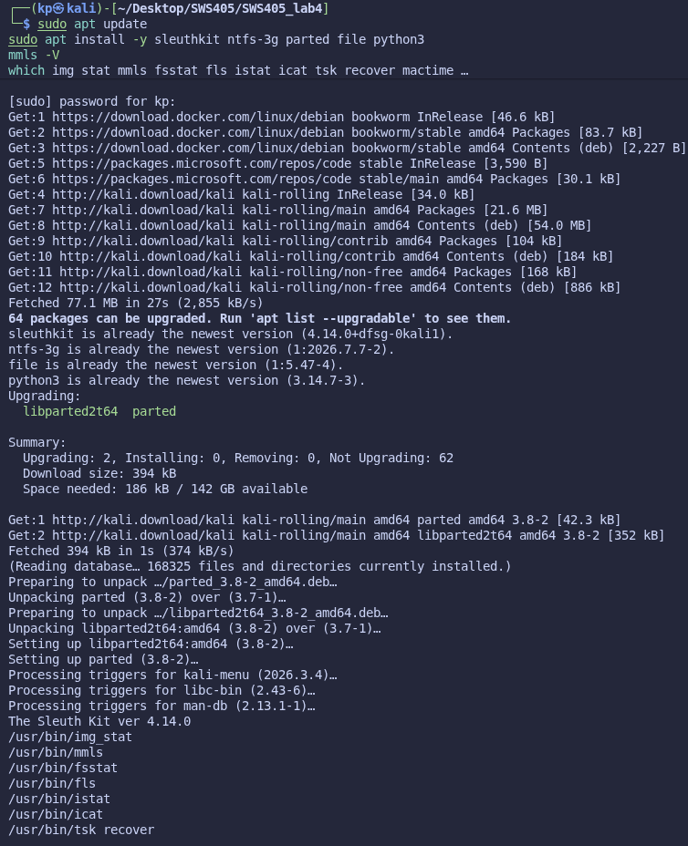
*Step 1 — TSK installed and verified (`mmls -V` and tool paths)*

### Part 2 — Build the evidence image
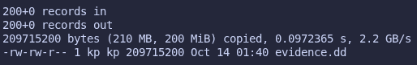
*Step 2.1 — Blank 200 MiB image created with `dd`*

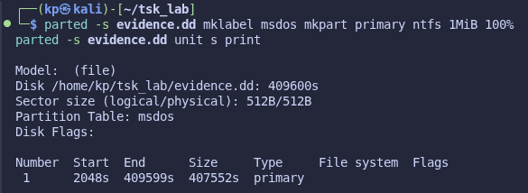
*Step 2.2 — Partition table written; partition Start = 2048s*

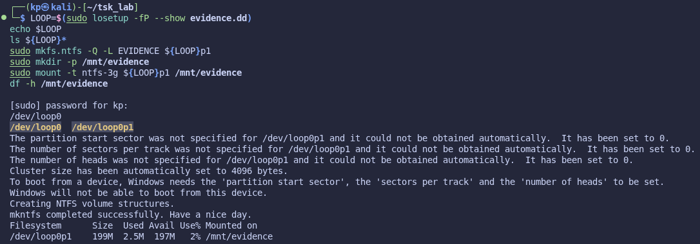
*Steps 2.3–2.5 — Loop device attached, NTFS formatted, partition mounted*

### Part 3 — Plant files and hash them
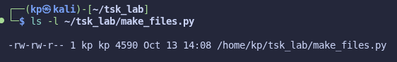
*Step 3.1 — Generator script `make_files.py` created*

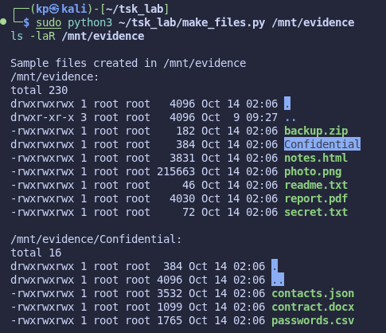
*Step 3.2 — Nine files planted (`ls -laR /mnt/evidence`)*

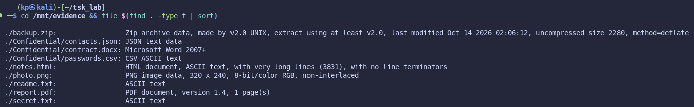
*Step 3.3 — File types confirmed by content (`file`)*

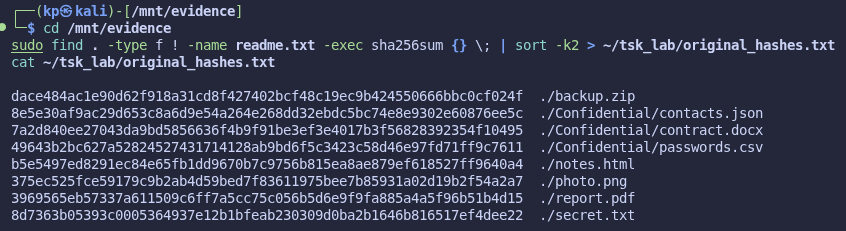
*Step 3.4 — Original SHA-256 hashes recorded*

### Part 4 — Delete the files and seal the image
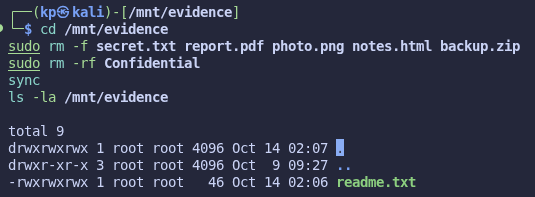
*Step 4.1 — Files deleted; only `readme.txt` remains*

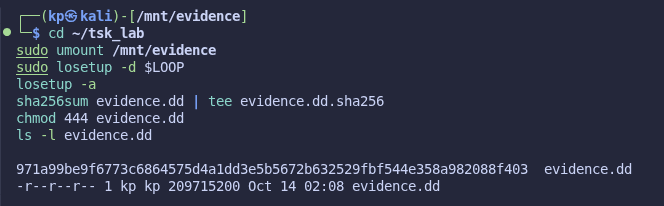
*Steps 4.2–4.4 — Unmounted, acquisition hash taken, image set read-only*

### Part 5 — Investigate the image with TSK
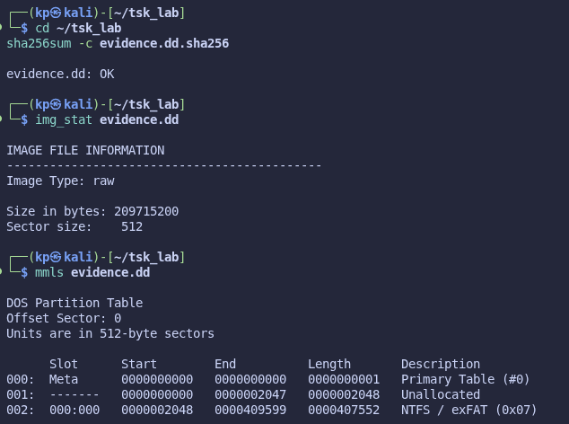
*Steps 5.1–5.3 — Integrity OK, `img_stat`, `mmls` (Start 2048)*

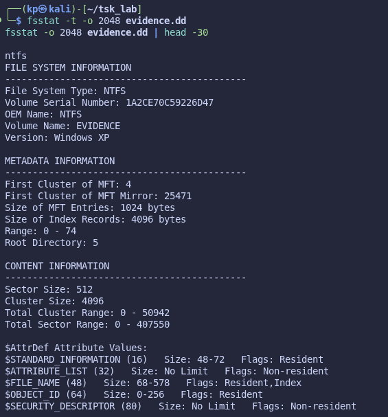
*Steps 5.4–5.5 — `fsstat`: NTFS, volume EVIDENCE, cluster 4096, MFT range 0–74*

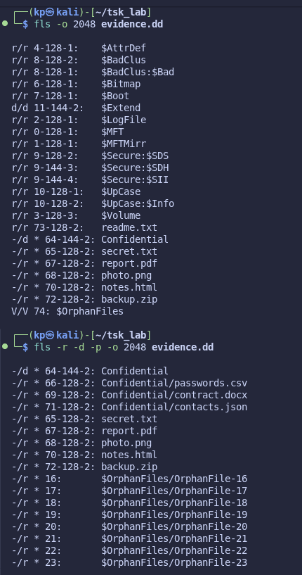
*Steps 5.6–5.7 — `fls`: deleted files found with MFT entries 65–72*

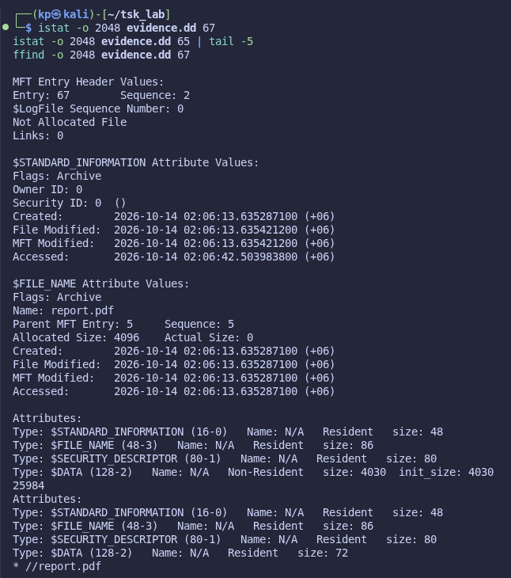
*Step 5.8 — `istat`: report.pdf non-resident (cluster 25984), secret.txt resident*

### Part 6 — Recover every deleted file and verify
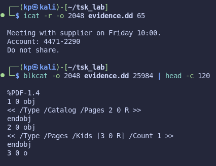
*Steps 6.1–6.2 — `icat` reads secret.txt; `blkcat` shows `%PDF-1.4` in the raw cluster*

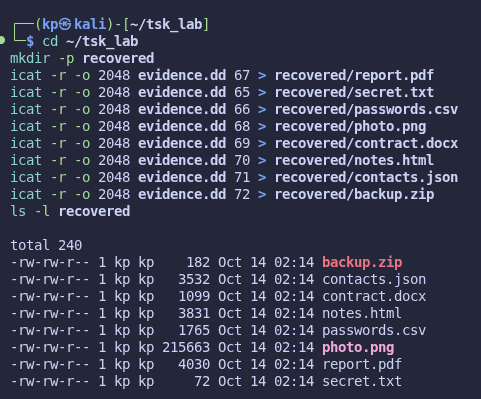
*Steps 6.3–6.4 — All 8 files recovered with `icat` (sizes match originals)*

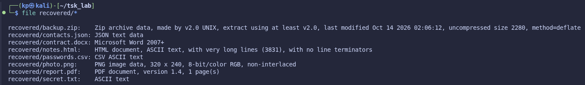
*Step 6.5 — Recovered file types confirmed with `file`*

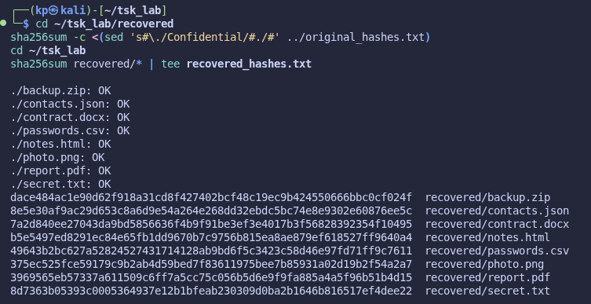
*Step 6.6 — ⭐ `sha256sum -c`: 8 of 8 recovered files OK*

### Part 7 — Bulk recovery, timeline and final integrity
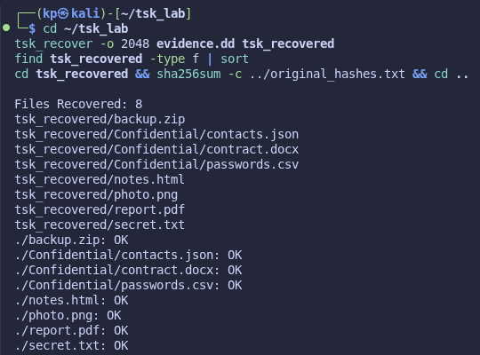
*Step 7.1 — `tsk_recover`: 8 files recovered, folder tree rebuilt*

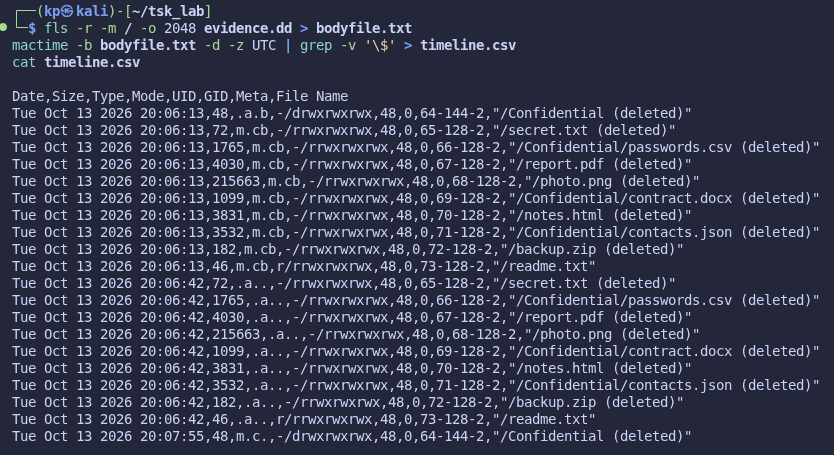
*Step 7.2 — MACB timeline (`fls -m` + `mactime`)*

*Step 7.3 — ⭐ Final `sha256sum -c`: evidence.dd OK (image unaltered)*
